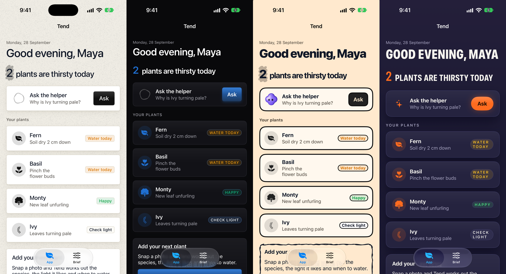

# Enhancement Skill

**Human touch for SwiftUI apps.** Five design kits clubbed into one package and one skill that starts with the people an app is for, not with a style.

Editors feature apps that feel made for someone. Enhancement Skill turns a short human brief (who, what moment, what feeling, what's at stake) into a single coherent direction, then applies exactly the kits that direction calls for:

| Kit | What it brings | Repo |
|---|---|---|
| **DesignSkills** | 67 complete design systems: palette, type, surfaces, components | [DesignSkillsSwiftUI](https://github.com/hemal08ce094/DesignSkillsSwiftUI) |
| **Drawably** | Hand-drawn pen accents and sketched controls | [DrawablySwiftUI](https://github.com/hemal08ce094/DrawablySwiftUI) |
| **Thinking Orbs** | Dotted 3D indicators for AI work in progress | [ThinkingOrbsSwiftUI](https://github.com/hemal08ce094/ThinkingOrbsSwiftUI) |
| **Bot Avatars** | Animated assistant characters with living faces | [BotAvatarsSwiftUI](https://github.com/hemal08ce094/BotAvatarsSwiftUI) |
| **Impeccable** | SwiftUI craft rules, 22 design commands, anti-pattern detector | [ImpeccableSwiftUI](https://github.com/hemal08ce094/ImpeccableSwiftUI) |



*The same sample app ("Tend") under four briefs: calm companion (Paper, pen highlight, orb), trusted tool (Enterprise, no sketches), playful maker (Fiction, sketched cards, clover bot), bold performer (Power).*

## How it works

```
Touch Brief  ──►  TouchProfile  ──►  TouchDirection  ──►  .humanTouch(…)  ──►  editorial audit
(the humans)      (6 traits)         (style, pen, assistant,    (one modifier)      (impeccable +
                                      motion, haptics, why)                          checklist)
```

1. **Understand.** The skill reads the app and writes `TOUCH.md`: one specific person, their moment, the feeling to leave them with, what must never happen, the signature moment. It asks at most three questions.
2. **Derive.** The brief becomes six traits (energy, warmth, craft, stakes, moment, assistant). `TouchDirector` maps them to one DesignSkills style, how much Drawably texture, whether the assistant is an orb or a bot, the spring, and the haptics, with a plain-language reason for each.
3. **Apply.** One root modifier, then direction-aware views that know when to be sketchy and when to stay clean.
4. **Audit.** The Impeccable detector plus an editorial-readiness checklist (accessibility, every state, platform reach, store presence).

Guardrails are built in: high-stakes apps never get playful styles or sketched controls, glanceable surfaces stay clean, one style per app, and a bot only when people actually talk to the assistant.

## The package

```swift
.package(url: "https://github.com/hemal08ce094/EnhancementSkill", from: "0.1.0"),
.product(name: "HumanTouch", package: "EnhancementSkill"),
```

iOS 18, macOS 15, visionOS 2. `import HumanTouch` re-exports all four runtime kits (Bot Avatars on iOS and visionOS; macOS falls back to an orb).

```swift
import HumanTouch

let tend = TouchProfile(
    name: "Tend", audience: "Plant owners checking in after work",
    feeling: "Calm and capable",
    energy: 0.3, warmth: 0.8, craft: 0.6,
    stakes: .everyday, moment: .linger, assistant: .quiet)

ContentView().humanTouch(tend)

// Direction-aware building blocks
Text("3 days").touchEmphasis()                         // pen highlight, or bold primary when sketches are off
TouchThinking(.solving)                                // Thinking Orb at the profile's pace
TouchAssistant(vm.isStreaming ? .working : .idle)      // bot, orb or nothing
TouchCard(expressive: true) { … }                      // sketched on expressive surfaces when craft allows
TouchButton("Start", expressive: true) { … }           // haptics matched to energy
content.touchAnimation(value: state)                   // one consistent spring, off under Reduce Motion

TouchDirection(tend).rationale                         // why it looks like this
```

Notes:
- `TouchAssistant` draws nothing when the brief has no assistant; show your own control there if the feature still exists.
- Dark-only and light-only styles (Power, Matrix…) force their scheme on the content under `.humanTouch`, not on system chrome. Set `.preferredColorScheme` at the window too if the tab bar should match.

### Presets

| Profile | For | Resolves to |
|---|---|---|
| `.calmCompanion` | journals, sleep, wellbeing | Paper style, pen accents, orbs, subtle haptics |
| `.trustedTool` | finance, health records, pro tools | Enterprise style, no sketches, orbs, subtle haptics |
| `.playfulMaker` | kids, learning, creative | Fiction style, sketched controls, clover bot, expressive haptics |
| `.boldPerformer` | fitness, events, streaks | Power style, no sketches, no assistant, expressive haptics |

The full trait → ingredient mapping is in [skill/enhancement-skill/references/mapping.md](skill/enhancement-skill/references/mapping.md).

## The skill

```sh
git clone https://github.com/hemal08ce094/EnhancementSkill
cd EnhancementSkill && ./install.sh          # links enhancement-skill + the 5 kit skills into ~/.claude/skills
```

Or install it as a Claude Code plugin from this repo (`.claude-plugin/`). Then ask Claude to "enhance my app's look and feel" or "make this app feature-worthy".

- [`skill/enhancement-skill`](skill/enhancement-skill/SKILL.md): the orchestrator. Touch Brief, mapping, API, editorial checklist.
- [`skills/`](skills/SOURCES.md): the five kit skills, synced from their repos by `scripts/sync-skills.sh`.

## Demo

`Demo/EnhancementDemo.xcodeproj` renders one sample app ("Tend", a plant-care journal with an AI helper) under any profile, next to a live Brief editor that shows the direction and its reasons. Launch arguments: `-profile calm|trusted|playful|bold`, `-tab app|brief`, `-scheme dark|light`.

## Development

```sh
DEVELOPER_DIR=/Applications/Xcode.app/Contents/Developer swift test     # director tests (macOS)
./scripts/sync-skills.sh                                                 # refresh bundled kit skills
```

## License

MIT. The bundled `impeccable-swiftui` skill is Apache 2.0 (see its LICENSE and NOTICE). Each kit keeps its own license and upstream credits in its repo.
